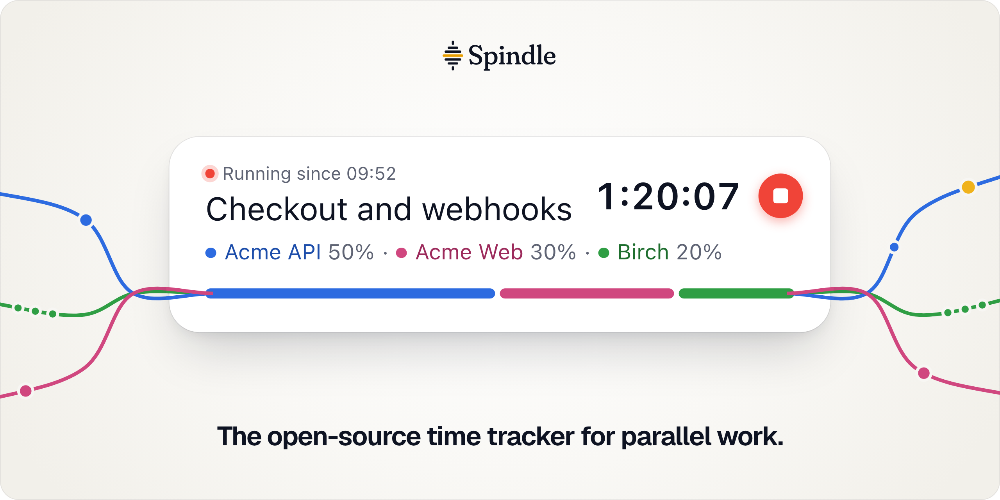
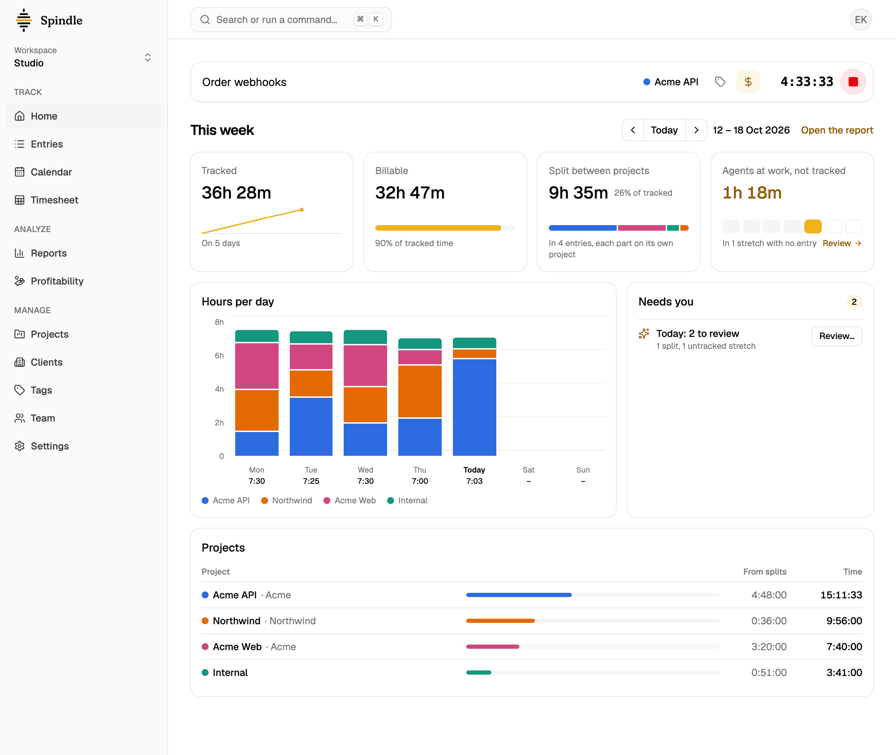
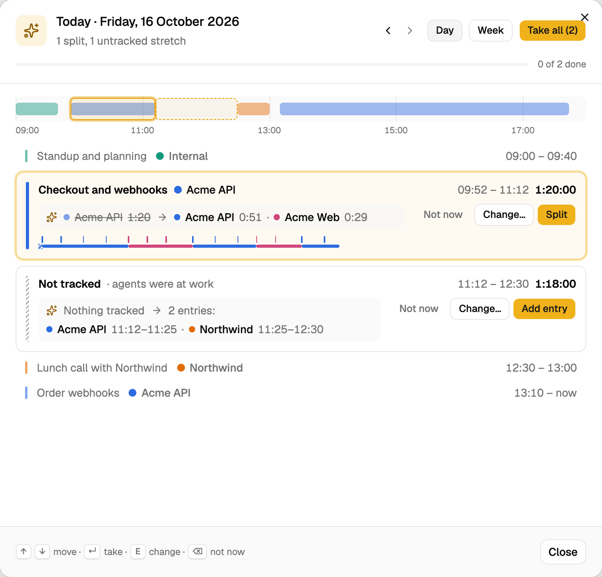
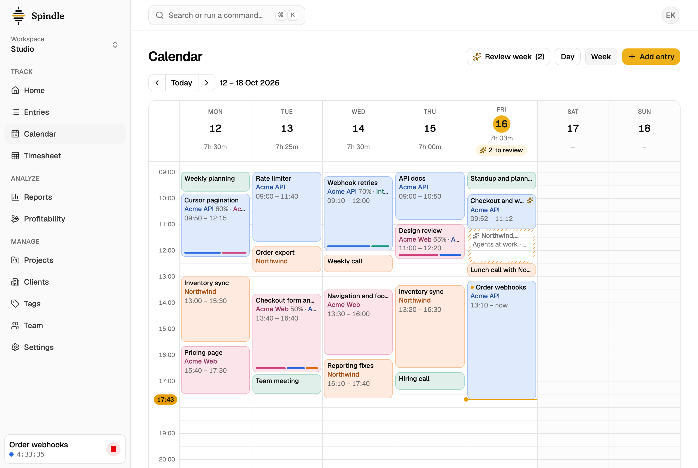
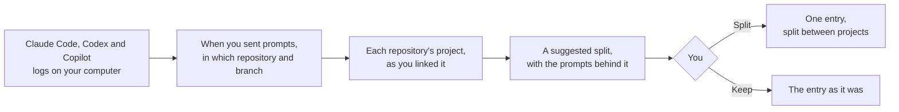

<picture>
  <source media="(prefers-color-scheme: dark)" srcset=".github/assets/readme-header-dark.png">
  
</picture>

  <a href="https://spindletrack.com">Website</a> ·
  <a href="https://spindletrack.com/docs">Docs</a> ·
  <a href="https://spindletrack.com/download">Download</a> ·
  <a href="https://app.spindletrack.com">Spindle Cloud</a> ·
  <a href="docs/self-hosting.md">Self-hosting</a> ·
  <a href="docs/roadmap.md">Roadmap</a>

A classic time tracker puts each entry on one project. With AI agents, you start the timer on the project you are
focused on, then hand off a small feature, a code review or a refactoring in one or two other projects while the agents
work. By the end of the day that time adds up, and it is recorded nowhere. You can't split it at the moments you
switched, because the work ran in parallel. Spindle lets an entry split its time between projects by share, and its
Mac and Windows apps can suggest the split from your Claude Code, Codex and GitHub Copilot CLI logs, read locally.
Nothing is saved until you confirm it.

It is a complete time tracker first: projects, clients, tasks and tags, billable and internal time, rates, reports and
exports, teams, and apps for the web, the Mac, Windows, the iPhone and Android.

## What it does

- **A timer and a calendar** on the web, in native desktop apps for the Mac (with a menu bar) and Windows (in the
  notification area), and in phone apps for the iPhone and Android.
- **Split entries.** One entry can divide its time between two to six projects, and every report counts each part on
  its own project.
- **Suggestions from agent logs.** The Mac and Windows apps read your Claude Code, Codex and GitHub Copilot CLI logs on
  your computer and, when the evidence is clear, offer a split, with the prompts behind it. They also notice agent work no timer covered
  ("Start at 9:12?", or a block in the calendar to add). Everything waits in one review of the day, and only clear
  cases interrupt you. They keep timestamps, folders, branches and short session titles; they never keep your prompts
  or the agents' answers. With activity sync on, the web shows the same suggestions and review.
- **Your own agent can help.** Claude Code, Codex, Claude and other MCP clients can read your time, describe entries,
  start or stop the timer, and propose time to add or change, which you review before anything is saved
  ([docs/connect-agents.md](docs/connect-agents.md)).
- **Not surveillance.** No tracking of apps, windows or screenshots. In a team, each person tracks their own time.
- **Reports and exports**: summary and detailed reports, billable amounts and labor cost, CSV, Excel and PDF, and
  imports from Toggl Track, Clockify and Harvest.

<table>
  <tr>
    <td colspan="2">
    <picture>
      <source media="(prefers-color-scheme: dark)" srcset=".github/assets/readme-home-dark.png">
      
    </picture>
     Home: the timer, the week, and what is waiting for you.
    </td>
  </tr>
  <tr>
    <td width="50%">
    <picture>
      <source media="(prefers-color-scheme: dark)" srcset=".github/assets/readme-review-dark.png">
      
    </picture>
     The day's review: a split suggested from the agents' prompts, and agent work no timer covered.
    </td>
    <td width="50%">
    <picture>
      <source media="(prefers-color-scheme: dark)" srcset=".github/assets/readme-calendar-dark.png">
      
    </picture>
     The week in the calendar, with split entries and today's suggestions.
    </td>
  </tr>
</table>

Where it is going, and what it deliberately won't do, is in [docs/principles.md](docs/principles.md).

## How a split is suggested

Time between two prompts goes to the project of the first, and time the logs don't account for stays on the timer's
project. A split you set yourself is never judged against the logs. How it works in detail is in
[docs/splits-and-suggestions.md](docs/splits-and-suggestions.md).

What Spindle takes from the logs:

| Kept | Never kept |
| --- | --- |
| When each prompt was sent, and when agents were busy | Your prompts and the agents' answers |
| The repository and its branches | Code and files |
| Short session titles, only if you allow them | Which apps or windows you use, or screenshots |

The logs are read on your computer and stay there. Only if you turn on activity sync for your account do the Mac and
Windows apps send the first column to your Spindle server, with each repository named by its git origin and never by
its folder, so the web can show the same suggestions. It is yours alone: not admins, not reports. Turning sync off
deletes it.

## Use it

- **Spindle Cloud** at [app.spindletrack.com](https://app.spindletrack.com): nothing to install or run. A 90-day trial
  needs no card; after it, €5 per person a month.
- **Run your own server.** The same app, with nothing locked away: one Docker image and a PostgreSQL database. Start
  with [docs/self-hosting.md](docs/self-hosting.md).

The apps:

| Platform | What it is | Where to get it |
| --- | --- | --- |
| Web | The full app, including team and workspace settings; split suggestions with activity sync on | Spindle Cloud, or your own server |
| Mac | Native app with a menu bar; agent-log split suggestions and agent access | Download from the web app |
| Windows | Native app in the notification area; agent-log split suggestions and agent access | Download from the web app |
| iPhone | Timer, entries, calendar, reports and projects | [App Store](https://apps.apple.com/app/id6821638286) |
| Android | Timer, entries, calendar, reports and projects | [Google Play](https://play.google.com/store/apps/details?id=com.spindletrack.android) |

The Mac, Windows and Android apps work with Spindle Cloud or with your own server. The iPhone app connects to Spindle
Cloud for now; [docs/self-hosting.md](docs/self-hosting.md#what-works-differently-on-your-own-server) says what works
differently on your own server.

## Build it

The backend is ASP.NET Core with PostgreSQL, the web app React and TypeScript, the Apple apps Swift and SwiftUI, the
Windows app .NET and Avalonia, and the Android app Kotlin and Jetpack Compose. How to run it locally, run the tests and
send a change is in [CONTRIBUTING.md](CONTRIBUTING.md). How the code is organised is in
[docs/architecture.md](docs/architecture.md), and the apps in [apple/README.md](apple/README.md),
[windows/README.md](windows/README.md) and [android/README.md](android/README.md).

## License

Spindle's code is under the [GNU Affero General Public License v3.0](LICENSE). If you run a modified version for
others over a network, the AGPL asks you to offer them its source: the web app links to it, and `App__SourceUrl` on
your server says where it is.

The Spindle name and logo are not under the AGPL; see [TRADEMARKS.md](TRADEMARKS.md). Third-party code and fonts keep
their own licenses, listed in [THIRD_PARTY_NOTICES.md](THIRD_PARTY_NOTICES.md).

Contributions are welcome under a [contributor license agreement](CLA.md); [CONTRIBUTING.md](CONTRIBUTING.md) explains
why. To report a vulnerability, see [SECURITY.md](SECURITY.md).

Spindle is made by [Threennovate](https://threennovate.com).
